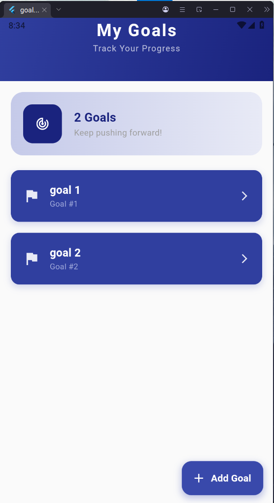
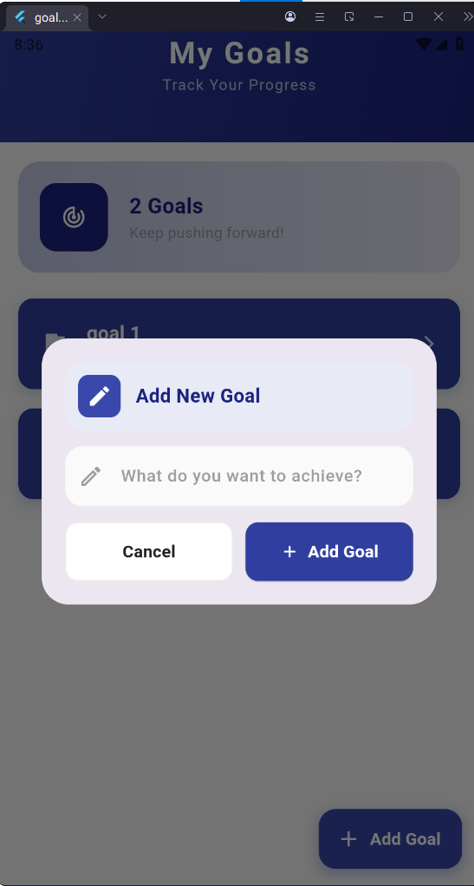
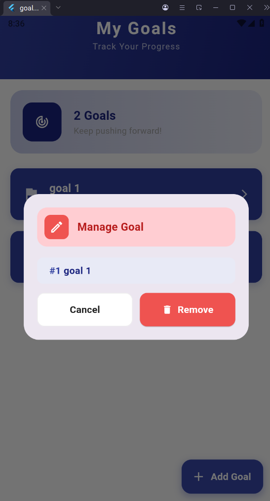

# 🎯 Goals App

A clean and intuitive Flutter application designed to help users organize, track, and manage their daily goals with ease. Built with modern Flutter best practices and reactive state management.

---

## 📱 App Preview

<p align="center">
  
  
  
</p>

---

## ✨ Key Features

- 🎯 **Goal Tracking:** Overview of total active goals and daily progress.
- ➕ **Add New Goals:** Quick and seamless modal to set what you want to achieve.
- ⚙️ **Goal Management:** Manage, inspect, and remove completed or unwanted goals.
- 🎨 **Modern UI/UX:** Clean dark blue themed cards with rounded aesthetics and responsive design.

---

## 🛠️ Tech Stack & Architecture

- **Framework:** [Flutter](https://flutter.dev/)
- **Language:** [Dart](https://dart.dev/)
- **State Management:** Flutter Bloc / Cubit (`GoalsCubit`)
- **Architecture:** Clean component structure (`cubits`, `screens`, `colors`)

---

## 🚀 Getting Started

To run this application locally on your machine:

1. Clone the repository:
   ```bash
   git clone [https://github.com/MennaElwan155/goals_app.git](https://github.com/MennaElwan155/goals_app.git)
